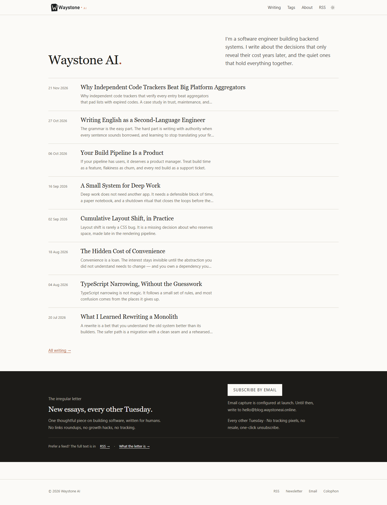
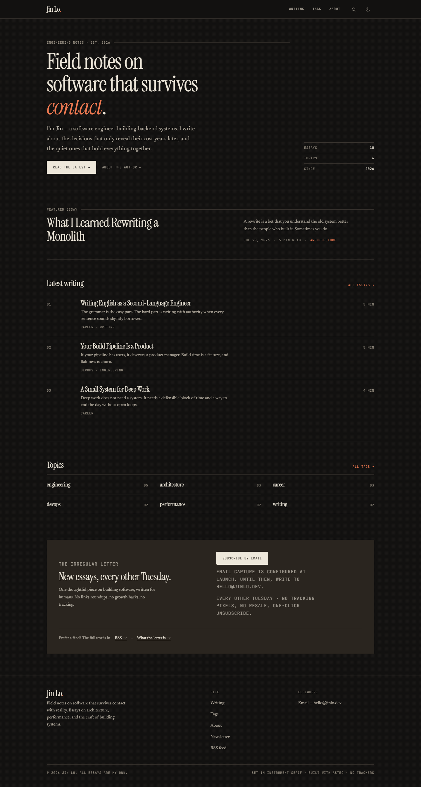
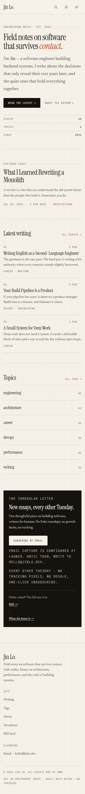

# UI 复查与收敛改造

> **已被取代**：本文记录的是 v1.1 的收敛过程（朱红 `#B23A1B` + 旧纸色），
> 现行设计见 [design-v2-direction.md](design-v2-direction.md)，现行对比度结论见
> [contrast-audit-v2.md](contrast-audit-v2.md)。仅作历史记录保留。

> 阶段 3 · v1.1 · 2026-11-13
> 范围：首页 `/`、归档列表 `/blog`、文章页 `/blog/<slug>`；亮 / 暗双主题；390 / 768 / 1440 三个断点
> 关联文档：[design-system.md](design-system.md) · 实现：[global.css](../src/styles/global.css)

## 0. 结论先行

**视觉方向不需要推翻，问题出在“系统漂移”和“装饰过量”，不是风格选错了。**

纸张底色、三种字体（Instrument Serif / Newsreader / JetBrains Mono）、单一朱红强调色、
发丝线替代卡片——这套编辑体语言本身是成立的，也确实是站点辨识度的来源。让人觉得“凌乱”的
是三件可以局部修复的事：

1. **设计文档与代码脱节**：文档写 12 级字号，CSS 里实际有 26 个字号字面值；文档写 “Google Fonts”，
   实际早已自托管；文档写 `--ink-faint: #7A7264`，代码是 `#6E6659`。规范没有约束力，样式就靠逐个
   页面“手感”拼，最后每页都略有不同。
2. **装饰元素与内容抢位**：首页有两块斜纹引用牌，占的面积比文章标题还大，写的却是装饰性文字
   （“From the archive”“Note 001”）。
3. **边缘密度过高**：几乎每个元素都有边框或横线——标签是框、分享按钮是框、作者卡是框、区块之间是线、
   每个二级标题上方还有一条通栏线。所有东西都有边，读者就无法从“边”读出层级。

因此本次只做**收敛**：建立字号与间距的硬约束、删掉重复装饰、把“每个边界一条线”改成“一种边界一种线”，
并修掉对齐与暗色对比的硬伤。组件结构、文案、字体、色板基本不动。

---

## 1. 诊断方法

不是凭观感，而是三类证据：

1. **源码逐条比对**：把 `global.css`（改造前 2182 行）里所有 `font-size`、`letter-spacing`、
   `padding`、`border` 字面值提取出来，与 `design-system.md` 声明的规范对账。
2. **运行时测量**：用 Chrome DevTools Protocol 在 6 种组合下加载三个页面（390 / 768 / 1440 × 亮 / 暗），
   读取 `documentElement.scrollWidth`、关键元素包围盒、计算后的字号 / 字重 / 字距集合。
3. **截图比对**：同一组参数下的整页截图，人工确认线、框、留白的实际观感。

> 说明：手机断点用 CDP 的 `Emulation.setDeviceMetricsOverride` 模拟。Windows 上 Chrome 的
> `--window-size=390` 受最小窗宽限制，会把 500px 布局裁成 390px 截图，产生“假溢出”，不能作为依据。

---

## 2. 凌乱的具体来源

### 2.1 字号阶梯失控

- 改造前 CSS 里有 **26 个不同的字号字面值**：9、10、11、12、13、14、15、16、17、18、20、21、22、
  24、26、28、30、32、38、40、48、56、60、64、72、80px。
- 其中 **15 / 16 / 17 / 18 / 20px 五个档位挤在 5px 区间**。列表行的日期、描述、正文、导语分别落在
  不同档位，但读者根本分辨不出差别——只会觉得“字有点乱但不说不清哪里乱”。
- 同一语义角色有多个尺寸：页头文字标 24px，页脚文字标 32px；页面 H1 在首页是 `clamp(2.75, 6.4vw, 5rem)`，
  在列表页是 `clamp(2.5, 5.5vw, 3.75rem)`，在文章页是 `clamp(2.25, 5vw, 3.5rem)`——三套互不相关的插值。
- **三套“区块标签”** 各写各的：首页 `.eyebrow`（灰 + 右侧长线）、精选区 `.featured-kicker`（强调色 + 圆点）、
  列表页 `.year-label`（灰 + 右侧长线，但字距不同）。三种写法表达同一个概念。

### 2.2 边缘密度（凌乱感的最大来源）

| 位置 | 改造前的边缘 | 数量 |
| --- | --- | --- |
| 列表页每一行 | 2–3 个描边标签胶囊 | 10 行 ≈ 25 个方框 |
| 文章正文 | 每个二级标题上方一条通栏横线 | 本篇 6 条 |
| 文章页尾 | 分享行（上下两条线）、作者卡（整圈边框 + 底色）、上下篇（上下两条线）、相关阅读（列表线）、订阅色带 | 5 个模块连续堆叠，共 9 条线 + 1 个框 |
| 列表页头部 | 页头底线与年份标签横线相邻 | 约 30px 内两条通栏线 |
| 首页区块 | `.section` 上边线 + `.post-list` 上边线 + `.section-head` 下边距 | 标题下方出现双线 |

结果是**边框不再表示层级**：一个装饰性的标签胶囊和“作者卡”这种真实容器拥有同样粗细、同样颜色的边。
读者看到的是一片等价的方框。

### 2.3 装饰元素抢戏

- 首页英雄区右侧一块 `.plate`：135° 斜纹底 + 朱红圆点 + 一句引用 + 两段元信息（“From the archive”“10 essays”）。
- 精选区右侧**第二块同样的** `.plate`（“Note 001”“On maintenance”）。
- 斜纹还出现在作者头像位置（`.avatar-plate`），与 `body` 的 4px 点阵底纹叠加，构成**三种纹理**。
- “Featured essay” 用强调色 + 圆点，视觉重量高于它下面的标题。

第一屏里，装饰性文字（引用、编号、图版说明）的信息量超过了真实的文章标题。用户说“凌乱”，本质是
**注意力被无信息量的元素分走了**。

### 2.4 对齐网格断裂（文章页）

- 1440px 下实测：`H1` 左缘在 **160px**，正文左缘在 **424px**，错位 **264px**（正好是目录栏 200px + 间距 64px）。
- 同时存在三套宽度：文章头部 `860px`、容器 `1120px`、正文 `68ch`。标题、导语、正文、页尾各对齐一条线，
  读者的视线每往下走一段就要重新找左边。
- 列表页与首页没有这个问题（都在容器左缘对齐），所以文章页显得格外“歪”。

### 2.5 间距不成体系

- 区块上下留白：`40 / 44 / 56 / 64 / 72`px 混用。
- 元素间距：`6 / 10 / 14 / 18 / 20 / 22 / 26 / 28 / 36 / 44`px 混用。
- “标题 → 描述 → 元信息”这组最常见的三层结构，在不同区块分别用了 3 种不同间距。
  留白没有节奏，读者感受到的是“忽紧忽松”，而不是“疏密有致”。

### 2.6 强调色分散

改造前首屏及紧邻区块里可见的强调色元素：文字标圆点、H1 斜体词、两块引用牌的圆点、精选标签的文字与圆点、
两个区块入口链接——**7 处**。设计系统明确写着“强调色必须稀缺”，实际执行成了“每个区块都要点一下”。

### 2.7 暗色主题对比失衡

| Token | 用途 | 改前对比度 | 改后对比度 |
| --- | --- | --- | --- |
| `--rule`（暗）`#2E2A25` → `#3A3530` | 全部发丝线与边框 | **1.32:1** | **1.56:1** |
| `--band-bg`（暗）`#191715` → `#2A251F` | 订阅色带 | **1.06:1** | **1.24:1**，另加 1px 边框 |
| `--ink`（暗）`#EDE7DA` | 正文 | 15.5:1 | 15.5:1 |
| `--ink-soft`（暗）`#B9B1A4` | 次级正文 | 9.1:1 | 9.1:1 |
| `--ink-faint`（暗）`#9A9285` | 元信息 | 6.1:1 | 6.1:1 |

暗色下的核心矛盾是：**整套版式依赖发丝线，但线在近黑底上几乎不可见**（1.32:1），于是区块、行、
页头页脚的边界全部糊在一起；而订阅色带与页面只差 1.06:1，在暗色下基本消失，原本“明暗反转”的
节奏变成了“一整片黑”。这不是审美偏好，是可测的对比失衡。

### 2.8 移动端布局缺陷

- `.post-row` 在 ≤640px 下把 `row-body` 放在第二行整行、`row-meta` 也放在第二行第二列，
  **两者重叠**：标题较长时右端会被 “5 MIN” 压住。
- 首页“账簿”在三列布局下每列约 108px，“TOPICS 6” 这类组合挤在一起，标签与数值只差 17px。

---

## 3. 改造决策

原则：**先删，再统一，最后才加东西。** 本次没有新增任何视觉元素（除了把装饰牌换成三行真实数据）。

### 3.1 保留不改

- 纸张暖色 `#F6F2E9`、墨色、单一朱红 `#B23A1B` 及暗色 `#F07A52`。
- 三款字体与字号关系（衬线标题 + 衬线正文 + 等宽元信息）。
- 2px 圆角、无阴影（仅移动菜单与搜索浮层保留阴影）、4px 点阵纸纹。
- 文章页左侧目录、顶部阅读进度条、页面结构（Hero / Featured / Latest / Topics / Subscribe）。
- 所有英文文案。

### 3.2 建立硬约束（token 化）

在 `:root` 新增 9 级字号与区块间距变量，后续样式只允许引用这些值：

```css
--fs-meta: 0.6875rem;  /* 11px 等宽元信息 */
--fs-xs:   0.75rem;    /* 12px */
--fs-sm:   0.875rem;   /* 14px */
--fs-base: 0.9375rem;  /* 15px 次要正文 */
--fs-body: 1.125rem;   /* 18px 正文 */
--fs-lead: 1.25rem;    /* 20px 导语 */
--fs-h3:   1.375rem;   /* 22px */
--fs-h4:   1.5rem;     /* 24px */
--fs-h2:   1.75rem;    /* 28px */
--section-y: 64px;
```

- **删除 17px 档**：正文与描述不再用两个几乎一样的字号。页面基础字号统一为 18px。
- 主标题仍允许 `clamp`，但收窄到 `2.5rem–4.75rem`（首页）、`2.25–3.25rem`（内页），
  首页与内页的差距被拉开，而不是三个页面各写一套。
- 行内代码保留 `0.82em` 相对字号——这是为了让等宽字与衬线正文的 x-height 对齐，属于合理例外。
- 间距只取 4 的倍数，允许 `4 / 8 / 12 / 16 / 20 / 24 / 32 / 40 / 48 / 56 / 64 / 72 / 96`。

### 3.3 删除的装饰

| 删除项 | 理由 |
| --- | --- |
| 首页两块引用牌 `.plate`（含斜纹、圆点、假元信息） | 无信息量、面积大、重复两次 |
| 作者头像斜纹 `.avatar-plate` 底纹 | 第三种纹理，与纸纹冲突 |
| `.featured-kicker`（强调色 + 圆点） | 与 `.eyebrow` 语义重复，统一为灰色标签 + 细线 |
| 文章正文 H2 的通栏横线 | 6 条线把正文切成碎片；改用留白建立层级 |
| 列表行标签胶囊 | 每屏约 25 个方框，改为一行等宽纯文本 |
| 作者卡的外框与底色 | 改为一条顶部发丝线，与页尾其他模块同一语言 |
| 分享行底线、上下篇底线、年份标签横线 | 相邻模块只保留一条边界线 |
| `.post-list` 顶部横线 | 与区块上边线、年份标签线重复 |

### 3.4 重排

- **首页英雄区**：右侧引用牌改为三行“账簿”（Essays / Topics / Since），水平细线分隔，无底纹无边框。
  面积从 300px 高降到约 96px，首屏回到“标题 + 导语 + 两个入口”。
- **精选区**：恢复 7:5 两栏但去掉右侧图版——左栏标题，右栏描述 + 元信息。既填补了右半空白，
  又形成“大标题 / 小字说明”的清晰主次。
- **文章页**：整块变为 900px 居中；≥1200px 时标题区 `padding-left: 264px`，与正文左缘**严格重合**。
  实测 1440px 下两者左缘均为 534px，错位从 264px 降到 **0**。
- **列表页头部**：元信息与搜索按钮并为一行（`.page-tools`），筛选条紧随其后，减少一层竖向堆叠。
- **移动端列表行**：日期与阅读时长占第一行两端，标题正文独占第二行，不再重叠。
- **移动端账簿**：三列改为三行，标签左、数值右。

### 3.5 明确没有做的

- 不换字体、不换色板、不引入卡片 / 阴影 / 渐变。
- 不改组件结构与路由，不动英文文案。
- 不把列表行改成卡片网格——那会推翻“用线不用框”的编辑体方向。
- 不同步 `design-preview.html` 静态样张（见第 6 节）。

---

## 4. 前后对比

| 维度 | 改造前 | 改造后 | 证据 |
| --- | --- | --- | --- |
| CSS 字号字面值 | 26 个（9–80px） | 由 9 级 token 约束 | 源码 |
| 首页实际渲染字号种类 | ≈16（按样式推算） | **10 种** | 1440 实测 |
| 列表页实际渲染字号种类 | ≈12（按样式推算） | **7 种** | 1440 实测 |
| 文章页实际渲染字号种类 | ≈18（按样式推算） | **11 种** | 1440 实测（含行内 code） |
| 区块标签写法 | 3 套 | 1 套（`.eyebrow`） | 源码 |
| 首页装饰块 | 2 块斜纹引用牌 | 0 | 截图 |
| 列表页描边胶囊 | 约 25 个 | 0 | 截图 |
| 文章正文通栏横线 | 6 条（每个 H2 一条） | 0 | 截图 |
| 文章页尾方框 | 1 个作者卡 + 9 条线 | 0 个框，4 条边界线 | 截图 |
| 文章标题 / 正文左缘 | 160px / 424px，错位 264px | 534px / 534px，错位 0 | CDP 实测 |
| 暗色发丝线对比 | 1.32:1 | 1.56:1 | 亮度公式计算 |
| 暗色订阅色带 | 1.06:1，几乎不可见 | 1.24:1 + 1px 边框 | 截图 + 计算 |
| 移动端列表行 | 标题与 “5 MIN” 重叠 | 两行分离 | 390 实测 |
| 横向溢出 | — | 0（文章表格内部滚动除外） | CDP 实测 |

> 改造前的页面级字号种类没有在改造前用同一工具测量（当时只做了源码统计），表中标“按样式推算”的
> 数值是根据旧规则实际会应用到的字号估算的；改造后的数值为运行时实测。

最终效果（1440 亮色首页）：



暗色首页（发丝线与订阅色带均已可见）：



---

## 5. 断点与主题实测记录

测量方式：CDP `Emulation.setDeviceMetricsOverride` + `Emulation.setEmulatedMedia`，
读取 `scrollWidth` 与所有元素的包围盒，越界判定为 `right > innerWidth + 1`。

| 页面 | 390 亮 / 暗 | 768 亮 / 暗 | 1440 亮 / 暗 |
| --- | --- | --- | --- |
| `/` | 无溢出 / 无溢出 | 无溢出 / 无溢出 | 无溢出 / 无溢出 |
| `/blog` | 无溢出 / 无溢出 | 无溢出 / 无溢出 | 无溢出 / 无溢出 |
| `/blog/boring-architecture` | 表格内部横向滚动，页面无溢出 | 无溢出 | 无溢出 |

> 文章内的宽表格在 390px 下保留 `overflow-x: auto` 的内部滚动，这是有意的（数据表不适合卡片化）。

移动端首页（账簿三行、列表行首行放日期与阅读时长）：



质量门禁（改造后重跑）：

```
npm run build     通过（22 个页面）
npm run check     0 errors · 0 warnings · 0 hints（30 个文件）
npm run test:links 638 条内部引用 / 22 个页面，全部可解析
npm run test:seo   22 个页面，title/description/canonical/OG/JSON-LD/sitemap/RSS/robots 均有效
```

产物体积：CSS 单文件 30,705 B（改造前约 29 KB，增量来自新增 token 与少量重排规则）。

---

## 6. 遗留与后续建议

1. **`design-preview.html` 仍是 v1.0 样张**。它是阶段 3 的静态手稿，未同步本次改动；
   当前应以线上页面和 `global.css` 为准。若后续继续用它做评审，需要重做或删除，避免两份“真相”。
2. **`TagPill` 组件与 `.tag-pill` 样式已不在列表行使用**，仅作为可选组件保留。
3. **`--ink-faint` 浅色为 `#6E6659`，在纸色上约 5.1:1**，达标但接近下限，只用于元信息，不要用于正文。
4. **文章内表格**在窄屏依赖内部滚动，未加滚动提示；若后续表格变多，可考虑加右缘渐隐。
5. 本次没有改 Lighthouse 分数相关的资源与加载策略；CSS 体积增加约 1.5 KB，可忽略。
